# Mumbai-Pune Travel Intelligence System: Master Engineering Report & System Architecture Manual

---

# CHAPTER 1: Executive Overview & Problem Formulation

## 1.1 The Operational Domain: Yashwantrao Chavan Mumbai-Pune Expressway (NH-48)
The Mumbai-Pune Expressway, officially designated the Yashwantrao Chavan Expressway, is India's first access-controlled, 6-lane, concrete toll highway. Spanning **94.5 kilometers** between Kalamboli (Panvel) and Dehu Road (Pune), and extending to a total operational transit corridor of **148 kilometers** when accounting for urban arterial ingress and egress from Sion Circle in Mumbai to Shivajinagar in Pune, it serves as the primary economic lifeline connecting India's financial capital with its technology and automotive hub. 

The corridor bears a continuous vehicular density exceeding **100,000 Passenger Car Units (PCUs) every 24 hours**, comprising a complex vehicular mix of passenger automobiles, intercity buses, light commercial vehicles (LCVs), and multi-axle freight containers transporting heavy industrial cargo from the Jawaharlal Nehru Port Trust (JNPT).

```
       [ARABIAN SEA]                                                       [DECCAN PLATEAU]
          Level 0m                                                             Level 560m
             |                                                                     |
Mumbai (Sion) -> Vashi -> Panvel -> Khalapur -> [BHOR GHAT ESCARPMENT] -> Talegaon -> Pune
  [R1: 8m]      [R1: 10m] [R2: 14m] [R3: 48m]      Khopoli: 72m            [R6: 582m] [R7: 560m]
                                              Khandala: 550m
                                              Lonavala: 624m (Peak)
```

Despite its modern geometric engineering, grade separation, and access restrictions, the Mumbai-Pune corridor remains one of the most hazardous transport links in Western India, recording hundreds of fatal accidents, severe multi-vehicle pileups, container rollovers, and complete gridlocks annually. The primary root cause of this vulnerability lies in the extreme geographical, meteorological, and mechanical transition occurring across the **Bhor Ghat (Khandala Ghat) mountain pass**.

---

## 1.2 Terrestrial, Meteorological, and Mechanical Failure Modes

### 1. The Bhor Ghat Topographic Wall
The highway transitions abruptly from the low-lying Konkan coastal plain at Khopoli (elevation: 72 meters above sea level) to the crest of the Sahyadri Western Ghats range at Lonavala (elevation: 624 meters above sea level). This represents a **vertical climb of 552 meters within an operational road distance of just 17 kilometers**, sustaining continuous longitudinal gradients ranging between **4.5% and 7.0%**.

### 2. Orographic Cloud Condensation and Sudden Fog Inversion
During the Southwest Monsoon season (June through October) and the winter morning transition period, moisture-laden maritime winds originating over the Arabian Sea travel eastwards across the Konkan plain and strike the sheer vertical rock wall of the Western Ghats. Forced upward by the terrain, the air undergoes adiabatic expansion and rapid cooling to its dew point temperature:

$$T_{\text{dew}} \approx T - \left(\frac{100 - \text{RH}}{5}\right)$$

This rapid adiabatic ascent triggers localized, severe orographic cloud condensation. Pavement visibility in the Khandala-Lonavala sector (km 81 to km 88) regularly plunges from **more than 5,000 meters to less than 50 meters in under 15 minutes**. Standard highway speeds cannot be arrested in time when drivers enter this sudden fog inversion, producing devastating rear-end chain collisions.

### 3. Mechanical Brake Overheating and Kinetic Thermal Fade
For heavy commercial vehicles and intercity buses descending the Ghat from Lonavala toward Khopoli, the continuous 6% downward grade requires enormous energy dissipation. An average 25-metric-ton multi-axle truck converts gravitational potential energy directly into thermal heat:

$$\Delta U = m \cdot g \cdot \Delta z = 25,000\text{ kg} \times 9.80665\text{ m/s}^2 \times 478\text{ m} \approx 1.17 \times 10^8\text{ Joules} = 117\text{ Megajoules}$$

When drivers ride the service friction brakes rather than relying on low-gear engine compression retarding, drum and rotor temperatures surge past **$400^\circ\text{C}$**. At these temperatures, the resin bonds within brake linings vaporize, producing gas layers between pad and disc (friction fade), while brake fluid boils into vapor pockets inside caliper lines. Mechanical braking capability drops to near zero, creating uncontrollable runaway heavy vehicles on narrow mountain curves.

### 4. Aquaplaning and Micro-Friction Degradation
The expressway's concrete pavements suffer from progressive tire-burnishing and surface polishing. During intense monsoonal cloudbursts ($>25\text{ mm/h}$ rainfall intensity), drainage cross-slopes become overwhelmed, creating standing water films ($h_w \ge 3.0\text{ mm}$). When a vehicle travels at high speeds, hydrodynamic pressure builds under the front tire footprint, eventually detaching the rubber from the road surface entirely. Dynamic hydroplaning initiates at speeds governed by tire pressure:

$$v_{\text{hydroplane}} \approx 6.36 \sqrt{p_{\text{tire}}}\text{ (km/h, where } p \text{ is in kPa)}$$

For a standard passenger car with tire pressure of $220\text{ kPa}$ (32 psi), hydroplaning occurs at **94.3 km/h**—below the statutory 100 km/h expressway speed limit.

### 5. Cellular Deprivation in Deep Tunnels
The corridor utilizes extensive multi-lane tunnels cut through solid basalt, notably the **Bhatan Tunnel (1,000 meters)** and **Madap Tunnel (300 meters)**. These structures act as complete electromagnetic Faraday shields, eliminating cellular carrier signals (4G/5G) and satellite GPS signals, leaving standard online navigation apps blind precisely where complex, multi-vehicle maneuvers occur.

---

## 1.3 Critical Inadequacies of Existing Commercial Platforms

| Operational Dimension | Commercial GPS Navigation (Google Maps, Waze, Apple Maps) | Standard Meteorological Apps (e.g., Weathervane, AccuWeather) | Mumbai-Pune Travel Intelligence Platform |
| :--- | :--- | :--- | :--- |
| **Primary System Objective** | Minimum Travel Time (ETA minimization) | Single-point ambient weather observations | **Holistic Safety Optimization ($0 - 100$) & Dynamic Safe Speeds** |
| **Micro-Climatic Spatial Resolution** | Completely absent (assumes static, uniform conditions) | Macro-city municipal level (e.g., "Mumbai 31°C" or "Pune 28°C") | **7 discrete micro-climatic regional sectors (R1 through R7)** |
| **Topographic Incline & Braking Model** | Flat 2D planar assumption; ignores grade physics | Completely absent | **Road friction ($\mu$), slope gradient ($G$), and stopping distance models** |
| **Mountain Pass Risk Adaptivity** | Uniform speed tracking; cannot anticipate sudden fog or slides | Generic probability of precipitation | **Ghat-Adaptive Dynamic Weighting (ML model boosted to 55%)** |
| **Temporal Decision Scanning** | Static historical traffic averages | 7-day municipal rain forecasts | **Deterministic $\pm 1\text{h}$ departure optimizer & 5-day corridor forecast** |
| **Dynamic Safe Speed Calculation** | Displays static statutory limit (100 km/h) in all weather | None | **Computes physics-based safe speed limits per sector** |
| **Tunnel Blind Spot Resilience** | System freezes; location jumps on tunnel exit | Application crashes or stalls without connectivity | **Pre-cached offline tunnel safety profiles and offline emergency dialing** |
| **Corridor Emergency Network** | Generic query for nearest police stations | None | **Direct-dial directory for IRB Control, MSRDC Patrol (1033), and Trauma Centers** |

---

# CHAPTER 2: Project Inception, Collaborative Evolution & Design Decisions

## 2.1 The Inception Phase: Conceptual Roots & Problem Formulation
The project was born out of an in-depth collaborative engineering process between user requirements and architectural planning (as documented in the historical inception records). Initial discussions revolved around the fundamental realization that **time-minimizing routing algorithms are inherently dangerous for extreme topography corridors**. A driver on the Mumbai-Pune Expressway needs to know whether the Ghat is safe, whether visibility has collapsed, what speed is physically safe given wet concrete friction, and whether delaying departure by 30 minutes avoids an orographic fog front.

Five foundational architectural milestones emerged during this planning phase:

### Milestone 1: Corridor Discretization into Seven Sectors
Rather than treating the 148 km journey as a single homogeneous link, the corridor was discretized into **7 distinct geopolitical, topographical, and administrative sectors (R1 through R7)**:
* **R1 (Sion to Panvel, 32 km)**: Urban expressway, coastal sea-level terrain, high vehicle density, Arabian Sea moisture.
* **R2 (Panvel to Khalapur Toll, 26 km)**: High-speed expressway straight, transition across the Konkan plain, high aquaplaning risk.
* **R3 (Khalapur to Khopoli Phata, 13 km)**: Toll plaza deceleration staging area, Ghat entry transition zone.
* **R4 (Khopoli Base to Khandala, 10 km)**: Bhor Ghat mountain ascent/descent, 6% sustained grade, tight hairpins, high brake fade and rockfall risks.
* **R5 (Khandala to Lonavala Crest, 7 km)**: Mountain summit, highest point (624m), peak orographic fog condensation, sudden zero-visibility.
* **R6 (Lonavala to Talegaon Toll, 30 km)**: Deccan volcanic plateau transition, descending straights, crosswinds, driver fatigue.
* **R7 (Talegaon to Pune Shivajinagar, 30 km)**: Industrial corridor, Dehu Road bypass, high local commuter and truck congestion.

### Milestone 2: The Dual-Persona Paradigm (Traveler vs. Planner)
A central realization in user behavior modeling was that **immediate travel requires tactical situational awareness**, whereas **future travel requires strategic predictive planning**:
* **The Traveler Persona (Immediate Departure)**: Evaluates live Google Maps Routes v2 radar, real-time municipal weather station telemetry, active community incident submissions, and immediate physical braking requirements.
* **The Planner Persona (Future Travel within 5 Days)**: Ingests 5-day / 3-hour atmospheric forecasts, diurnal temperature/humidity curves, historical regional XGBoost accident likelihoods, and scans departure time windows to identify optimal departure slots. Real-time transient incidents receive zero weight in the Planner model.

### Milestone 3: The Chatbot Separation Axiom
A core architectural principle established early in the project:
> *"Large Language Models must NEVER be permitted to compute numerical scores, evaluate physics equations, or determine safety classifications. LLMs are non-deterministic and hallucinate multi-variable math. All scores, weights, speeds, and recommendations must be computed by a deterministic Python engine, and then injected into the LLM system prompt as verified facts. The LLM serves solely as an empathetic, conversational synthesizer."*

### Milestone 4: Evolution of the Authentication Engine
* **Initial State**: Simulated local OTP auto-fill (discarded as artificial and insecure).
* **Intermediary State**: Fast2SMS cellular gateway (failed due to Indian TRAI DLT commercial sender registration bottlenecks).
* **Production State**: **Firebase Phone Authentication**, providing genuine cellular SMS OTP delivery, SHA-256 Android app verification, native auto-retrieval, and encrypted hardware keystore persistence (`FlutterSecureStorage`).

### Milestone 5: Discarding PDF Reports for In-App Relational Records
Early concepts called for generating downloadable PDF journey reports. Real-world mobile testing proved that PDF generation on mobile devices is fragile, visually non-responsive, and prevents users from interactively inspecting segment breakdowns. The system was re-architected to save structured JSON payloads directly into **Neon Serverless PostgreSQL** via a dedicated `TravelReport` entity, rendering interactive, offline-capable in-app report cards.

---

# CHAPTER 3: Core Engineering Axioms & Design Principles

```
┌──────────────────────────────────────────────────────────────────────────────────────────────────┐
│                                   CORE ENGINEERING AXIOMS                                        │
├──────────────────────────┬───────────────────────────────────────────────────────────────────────┤
│ Axiom 1: Deterministic   │ LLMs strictly prohibited from calculating math, scores, or speeds.    │
│ Authority                │ All computation executed by compiled, deterministic Python core.      │
├──────────────────────────┼───────────────────────────────────────────────────────────────────────┤
│ Axiom 2: Non-Zero Safety │ Missing secondary data (e.g. crowd reports) never defaults to 0.      │
│ Normalization            │ Active weights dynamically re-normalized to maintain 100% sum.        │
├──────────────────────────┼───────────────────────────────────────────────────────────────────────┤
│ Axiom 3: Timezone        │ Cloud server UTC aligned to Indian Standard Time (IST = UTC + 05:30). │
│ Discipline               │ All models, diurnal curves, and alarms operate strictly in native IST.│
├──────────────────────────┼───────────────────────────────────────────────────────────────────────┤
│ Axiom 4: Blackout        │ Mountain tunnels sever cellular connectivity. Key safety limits,      │
│ Resilience               │ speeds, and emergency directories pre-cached on client before entry.  │
├──────────────────────────┼───────────────────────────────────────────────────────────────────────┤
│ Axiom 5: Defensive       │ External API outages (Google, OpenWeather, Groq) fall back smoothly   │
│ Degradation              │ to static baselines and offline physics without application crashes.  │
└──────────────────────────┴───────────────────────────────────────────────────────────────────────┘
```

---

# CHAPTER 4: Complete UML Architectural Design Suite

## 4.1 UML Component Architecture Diagram
The platform is designed around a multi-tier, loosely coupled component architecture consisting of a client presentation layer, an API gateway, a deterministic core engine layer, an external integration layer, and a serverless database tier:

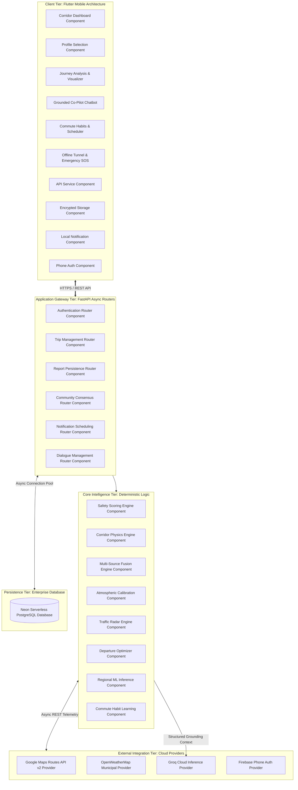

---

## 4.2 Comprehensive UML Class Diagram & Domain Model

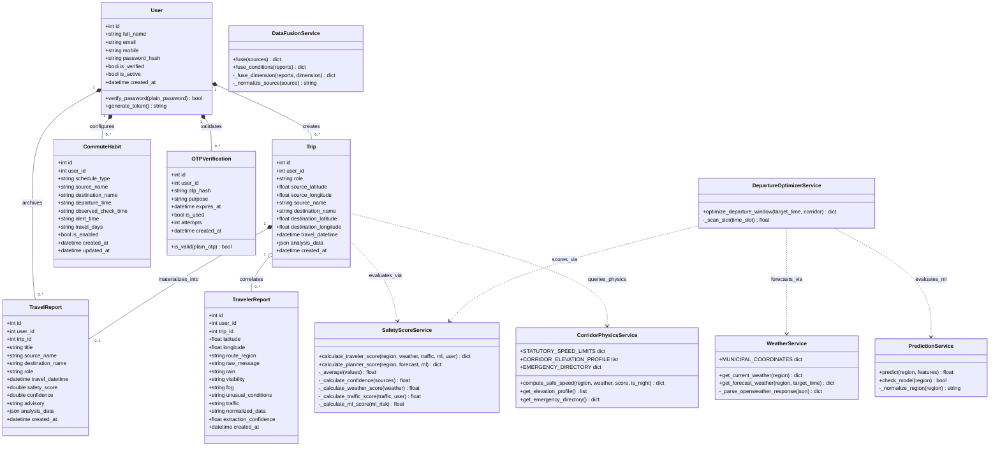

---

## 4.3 UML Use Case Specification

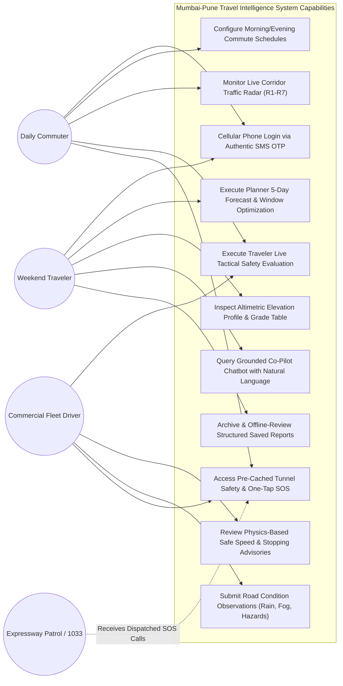

---

## 4.4 Comprehensive UML Sequence Diagrams

### 1. Traveler Tactical Evaluation Flow
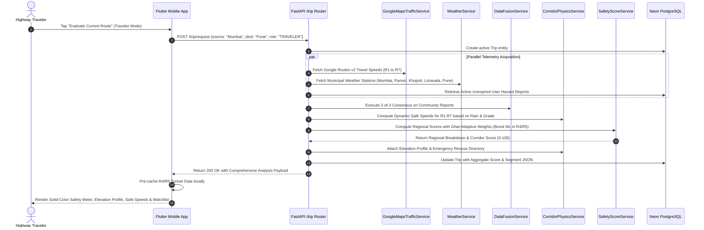

### 2. Planner 5-Day Forecast & Window Optimization Flow
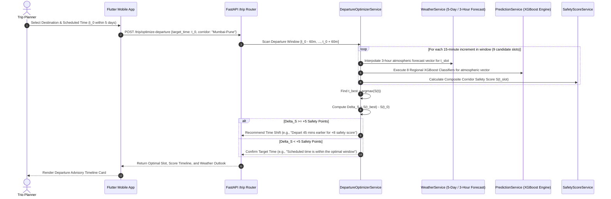

### 3. Community Hazard Crowdsourcing & Consensus Flow
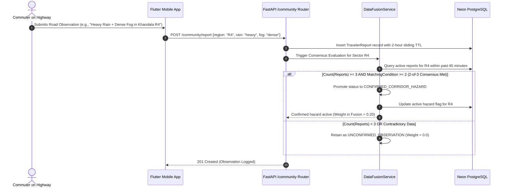

### 4. Background Commute Alert Scheduler Flow
```mermaid
sequenceDiagram
    autonumber
    actor Commuter as Daily Commuter
    participant MobileScheduler as Mobile AlarmManager / LocalNotifs
    participant App as Flutter Mobile App
    participant Gateway as FastAPI /notifications Router
    participant CommuteService as CommuteNotificationService
    participant Weather as WeatherService
    participant Traffic as GoogleMapsTrafficService

    Commuter->>App: Saves Daily Commute Schedule (07:30 AM, Panvel -> Pune, Mon-Fri)
    App->>Gateway: POST /notifications/habits {departure_time: "07:30", source: "Panvel"}
    Gateway->>CommuteService: Register habit in database
    App->>MobileScheduler: Schedule exact alarm for (07:30 - 30m) = 07:00 AM IST
    
    Note over MobileScheduler: App closed / Device in sleep mode
    MobileScheduler->>App: Wake device at 07:00 AM IST via Exact Alarm Receiver
    App->>Gateway: GET /notifications/evaluate-commute {habit_id: 12}
    Gateway->>CommuteService: Trigger Corridor Pre-Scan
    CommuteService->>Weather: Fetch live weather in Bhor Ghat
    CommuteService->>Traffic: Fetch Google Maps live travel delay
    
    alt Corridor Score < 70 OR Ghat Safe Speed <= 40 km/h
        CommuteService-->>Gateway: Alert Required: "Heavy rain in Bhor Ghat: Safe speed 40 km/h; +25m delay"
        Gateway-->>App: 200 OK with Alert Payload
        App->>MobileScheduler: Display High-Priority Heads-Up Push Notification
        MobileScheduler-->>Commuter: Ring notification banner with sound and haptics
    else Corridor Score >= 70
        CommuteService-->>Gateway: Corridor Clear: Score 88/100
        Gateway-->>App: 200 OK (Suppress notification)
    end
```

---

## 4.5 UML Activity Diagram: Multi-Source Safety Scoring Engine

```mermaid
flowchart TD
    Start([Start Corridor Safety Evaluation]) --> Ingest[Ingest Parallel Telemetry: Weather, Traffic, User, ML]
    
    Ingest --> NormWeather[Normalize Weather Telemetry: S_weather 0-100]
    Ingest --> NormTraffic[Normalize Google Routes Traffic: S_traffic 0-100]
    Ingest --> NormUser[Normalize Verified User Consensus: S_user 0-100]
    Ingest --> NormML[Normalize Regional XGBoost ML: S_ml 0-100]
    
    NormWeather & NormTraffic & NormUser & NormML --> CheckRole{Selected User Role?}
    
    CheckRole -->|PLANNER| PlannerBranch[Planner Scoring Mode]
    PlannerBranch --> SetPlannerWeights["Standard Weights: w_weather=0.60, w_ml=0.40"]
    SetPlannerWeights --> CheckGhatP{Is Region R4 or R5?}
    CheckGhatP -->|YES| BoostML_P["Boost ML Weight: w_weather=0.45, w_ml=0.55"]
    CheckGhatP -->|NO| CalcPlannerScore[Compute S_planner = sum(w_i * S_i)]
    BoostML_P --> CalcPlannerScore
    
    CheckRole -->|TRAVELER| TravelerBranch[Traveler Scoring Mode]
    TravelerBranch --> FuseTraffic["Fuse Traffic = 0.80 * S_google + 0.20 * S_user"]
    FuseTraffic --> SetTravelerWeights["Standard Weights: w_weather=0.35, w_traffic=0.30, w_ml=0.25, w_user=0.10"]
    SetTravelerWeights --> CheckGhatT{Is Region R4 or R5?}
    CheckGhatT -->|YES| BoostML_T["Boost ML Weight: w_weather=0.25, w_traffic=0.25, w_ml=0.40, w_user=0.10"]
    CheckGhatT -->|NO| CheckMissing{Are Any Telemetry Streams Missing?}
    BoostML_T --> CheckMissing
    
    CheckMissing -->|YES| Renormalize["Re-normalize Active Weights: w_i' = w_i / sum(w_active)"]
    CheckMissing -->|NO| CalcTravelerScore[Compute S_traveler = sum(w_i * S_i)]
    Renormalize --> CalcTravelerScore
    
    CalcPlannerScore & CalcTravelerScore --> PhysicsSafeSpeed["Compute Physics Dynamic Safe Speed (Grade, Friction, Visibility)"]
    PhysicsSafeSpeed --> MapColor["Interpolate Solid-Color Meter: Red <40, Orange 40-60, Amber 60-75, Mint 75-90, Emerald 90-100"]
    MapColor --> End([Output Structured Evaluation Payload])
```

---

## 4.6 UML State Machine Diagrams

### 1. Trip Entity Lifecycle State Machine
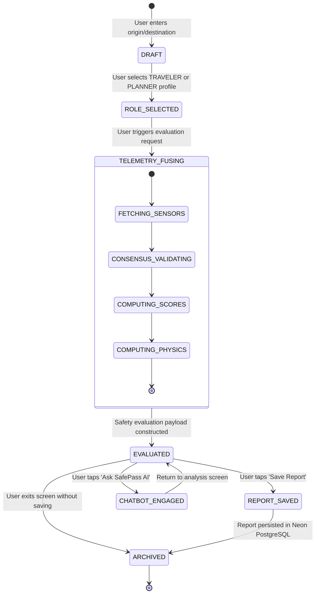

### 2. Commute Habit Alert State Machine
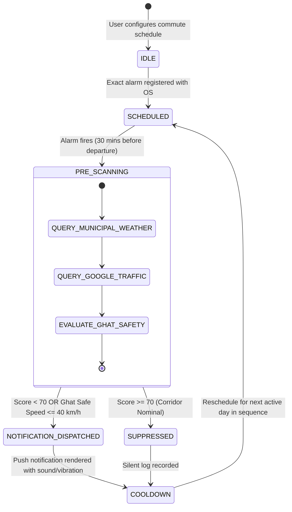

---

## 4.7 UML Deployment & Infrastructure Topology Diagram

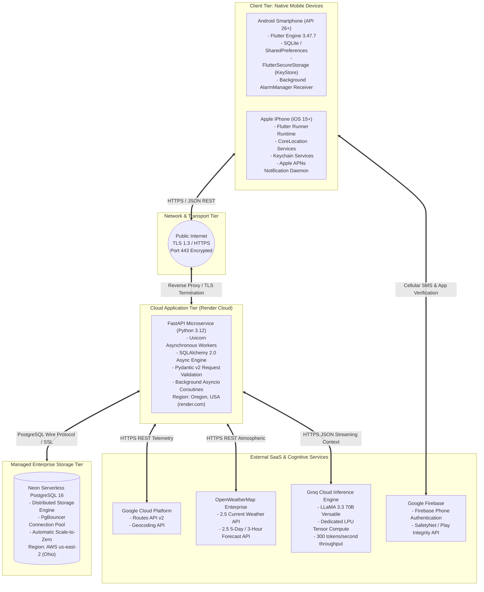

---

# CHAPTER 5: Corridor Topography, Micro-Climates & Altimetric Physics

## 5.1 Three-Tier Geological Elevation Hierarchy

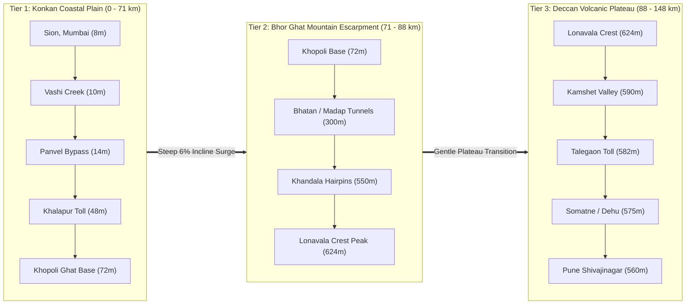

---

## 5.2 High-Resolution Altimetric Cross-Section

The following cross-section details the elevation profile along the 148 km corridor, showing key landmarks and vertical altitudes from sea level to the Western Ghats crest:

```
Elevation
  (m)
  700 +
      |
  650 +                                    * Lonavala Crest (88km, 624m) [PEAK]
      |                                   / \
  600 +                                  /   \
      |                    Khandala *   /     *--* Kamshet Valley (104km, 590m)
  550 +                  (81km, 550m) \/          \
      |                                *           *--* Talegaon Toll (118km, 582m)
  500 +                               /                \
      |                              /                  * Somatne Bypass (130km, 575m)
  450 +                             /                    \
      |                            /                      * Pune Shivajinagar (148km, 560m)
  400 +                           /
      |                          /
  350 +                         /
      |                        /
  300 +                       /
      |                      /
  250 +                     /
      |                    /
  200 +                   /
      |                  /
  150 +                 /
      |                /
  100 +               /
      |     Khopoli */
   50 +   (71km, 72m)
      |         * Khalapur Toll (58km, 48m)
    0 +--*------*---*
       Sion   Vashi Panvel
      (0km,  (15km, (32km,
       8m)    10m)   14m)
      +----+----+----+----+----+----+----+----+----+----+----+----+----+----+----+--> Distance
      0   10   20   30   40   50   60   70   80   90  100  110  120  130  140  150  (km)
```

---

## 5.3 Engineering Gradient & Kinematic Impact Table

The longitudinal slope grade $G$ is mathematically derived as:

$$G = \frac{\Delta z}{\Delta x \cdot 1000} \times 100\% = \frac{z_{\text{end}} - z_{\text{start}}}{(x_{\text{end}} - x_{\text{start}}) \times 1000} \times 100\%$$

The incline angle $\theta$ in radians and degrees is derived as:

$$\theta = \arctan\left(\frac{G}{100}\right)$$

| Highway Segment | Length ($\Delta x$) | Elevation Profile ($\Delta z$) | Gradient ($G$) | Incline Angle ($\theta$) | Mechanical & Dynamic Hazard Classification |
| :--- | :---: | :---: | :---: | :---: | :--- |
| **Sion $\rightarrow$ Vashi Bridge** | 15 km | $8\text{m} \rightarrow 10\text{m}$ ($+2\text{m}$) | $+0.013\%$ | $+0.007^\circ$ | High urban density; marine crosswind shear on Vashi bridge deck |
| **Vashi $\rightarrow$ Panvel** | 17 km | $10\text{m} \rightarrow 14\text{m}$ ($+4\text{m}$) | $+0.024\%$ | $+0.014^\circ$ | Multi-axle commercial traffic merging from JNPT port |
| **Panvel $\rightarrow$ Khalapur** | 26 km | $14\text{m} \rightarrow 48\text{m}$ ($+34\text{m}$) | $+0.131\%$ | $+0.075^\circ$ | High-speed expressway straights; standing water aquaplaning risk |
| **Khalapur $\rightarrow$ Khopoli** | 13 km | $48\text{m} \rightarrow 72\text{m}$ ($+24\text{m}$) | $+0.185\%$ | $+0.106^\circ$ | Toll plaza queuing turbulence; pre-Ghat staging zone |
| **Khopoli $\rightarrow$ Khandala** | 10 km | $72\text{m} \rightarrow 550\text{m}$ ($+478\text{m}$) | **$+4.780\%$** | **$+2.736^\circ$** | **Uphill engine thermal strain; downhill brake fade ($>400^\circ\text{C}$)** |
| **Khandala $\rightarrow$ Lonavala** | 7 km | $550\text{m} \rightarrow 624\text{m}$ ($+74\text{m}$) | **$+1.057\%$** | **$+0.606^\circ$** | **Orographic fog condensation; visibility collapses below 50m** |
| **Lonavala $\rightarrow$ Kamshet** | 16 km | $624\text{m} \rightarrow 590\text{m}$ ($-34\text{m}$) | $-0.213\%$ | $-0.122^\circ$ | Transition out of Ghat cloud deck; crosswinds through rock cuts |
| **Kamshet $\rightarrow$ Talegaon** | 14 km | $590\text{m} \rightarrow 582\text{m}$ ($-8\text{m}$) | $-0.057\%$ | $-0.033^\circ$ | Sustained high cruise speeds; driver monotony and fatigue |
| **Talegaon $\rightarrow$ Somatne** | 12 km | $582\text{m} \rightarrow 575\text{m}$ ($-7\text{m}$) | $-0.058\%$ | $-0.033^\circ$ | Dehu Road industrial bypass merging; mixed heavy commercial traffic |
| **Somatne $\rightarrow$ Pune** | 18 km | $575\text{m} \rightarrow 560\text{m}$ ($-15\text{m}$) | $-0.083\%$ | $-0.048^\circ$ | Urban commuter congestion; frequent stop-and-go shockwaves |

---

# CHAPTER 6: Kinematic Braking Dynamics & Dynamic Safe Speeds

## 6.1 Total Stopping Distance Formulation
The stopping distance $d_{\text{total}}$ consists of perception-reaction distance and braking deceleration distance:

$$d_{\text{total}} = d_{\text{reaction}} + d_{\text{braking}}$$

$$d_{\text{total}} = v \cdot t_r + \frac{v^2}{2g \cdot (\mu \cos\theta \pm \sin\theta)}$$

Where:
* $v$: Vehicle velocity ($\text{m/s} = \frac{\text{km/h}}{3.6}$)
* $t_r$: Perception-reaction time ($1.5\text{ s}$ standard; increased to $2.2\text{ s}$ under dense mist or night conditions)
* $g$: Gravitational acceleration ($9.80665\text{ m/s}^2$)
* $\theta$: Longitudinal road inclination angle ($\theta = \arctan(G / 100)$)
  * $+\sin\theta$ applies to **uphill** travel (gravity assists deceleration).
  * $-\sin\theta$ applies to **downhill** travel (gravity opposes deceleration).
* $\mu$: Interfacial tire-pavement friction coefficient, dynamically mapped to weather conditions:

$$\mu = \begin{cases} 
0.80 & \text{Dry, clean asphalt} \\
0.68 & \text{Dry grooved concrete (Expressway standard)} \\
0.55 & \text{Damp surface / light drizzle} \\
0.40 & \text{Moderate rainfall (wet film with partial groove evacuation)} \\
0.25 & \text{Heavy rainfall / standing water (high aquaplaning danger)} \\
0.18 & \text{Active mud, silt, or diesel sheen on wet pavement}
\end{cases}$$

---

## 6.2 Mathematical Proof: Flat Dry Plain vs. Wet Bhor Ghat Descent

Consider a vehicle cruising at **100 km/h** ($27.78\text{ m/s}$):

```
Scenario A (Dry Flat Plain: 100 km/h, mu=0.80, Grade=0%):
  Reaction Distance:  27.78 m/s * 1.5 s       =  41.67 meters
  Braking Distance:   (27.78)^2 / (2 * 9.81 * 0.80) =  49.18 meters
  -------------------------------------------------------------
  TOTAL STOPPING DISTANCE:                       90.85 meters

Scenario B (Wet Bhor Ghat Descent: 100 km/h, mu=0.25, Grade=-6%):
  Reaction Distance:  27.78 m/s * 1.5 s       =  41.67 meters
  Braking Distance:   (27.78)^2 / [2 * 9.81 * (0.25*0.998 - 0.060)]
                      = 771.6 / (19.62 * 0.1895)
                      = 771.6 / 3.718           = 207.53 meters
  -------------------------------------------------------------
  TOTAL STOPPING DISTANCE:                      249.20 meters  (2.74x INCREASE)
```

**Conclusion**: On a wet 6% downhill Ghat descent, stopping distance expands by **2.74 times** ($90.85\text{m} \rightarrow 249.20\text{m}$). If an obstacle emerges within a 100-meter fog sight window, a crash is physically inevitable at statutory limits. This proves the necessity of physics-based dynamic safe speeds.

---

## 6.3 Safe Speed Reduction Logic
The **Corridor Physics Service** calculates the recommended safe speed through a deterministic multi-factor reduction algorithm:

1. **Base Statutory Limit Retrieval**: R1/R7 default to $80\text{ km/h}$; R2/R3/R6 default to $100\text{ km/h}$; R4/R5 default to $50\text{ km/h}$.
2. **Pavement Friction Penalty**:
   * Heavy Rain / Aquaplaning: $-40\%$ of statutory limit.
   * Moderate Rain / Wet Asphalt: $-25\%$ of statutory limit.
   * Light Drizzle / Damp Pavement: $-15\%$ of statutory limit.
3. **Visibility Impairment Penalty**:
   * Severe Mist ($<1.0\text{ km}$ visibility): $-30\%$ of statutory limit.
   * Moderate Haze ($<3.0\text{ km}$ visibility): $-15\%$ of statutory limit.
4. **Mountain Incline Grade Penalty**:
   * In Ghat sectors (R4/R5), if any rain is active: an additional $-10\text{ km/h}$ penalty is enforced to compel low-gear engine braking and prevent thermal brake fade.
5. **Night Driving Penalty**:
   * If night transit is active on unlit sections with statutory limits $>60\text{ km/h}$: a $-10\text{ km/h}$ sight-distance penalty is enforced.
6. **Floor Clamping**:
   * Speeds are clamped to a hard physical floor: $35\text{ km/h}$ in mountain Ghats (R4/R5), and $50\text{ km/h}$ in plain sectors.

---

# CHAPTER 7: Multi-Source Fusion & Safety Scoring Mathematics

## 7.1 Dual-Persona Mathematical Formulations

### 1. Traveler Mode (Immediate Real-Time Fusion)
$$S_{\text{Traveler}} = w_{\text{weather}} \cdot S_{\text{weather}} + w_{\text{traffic}} \cdot S_{\text{traffic}} + w_{\text{ml}} \cdot S_{\text{ml}} + w_{\text{user}} \cdot S_{\text{user}}$$

Where traffic score $S_{\text{traffic}}$ is fused from Google Maps Routes v2 and verified crowd reports in an 80/20 ratio:
$$S_{\text{traffic}} = 0.80 \cdot S_{\text{GoogleMaps}} + 0.20 \cdot S_{\text{Community}}$$

### 2. Planner Mode (5-Day Atmospheric Forecast)
$$S_{\text{Planner}} = w_{\text{forecast}} \cdot S_{\text{forecast}} + w_{\text{ml}} \cdot S_{\text{ml}}$$

*(Note: Unverified transient reports and real-time traffic receive zero weight in the Planner profile, as momentary conditions cannot predict highway states days in advance).*

---

## 7.2 Ghat-Adaptive Dynamic Weighting Distribution

```
TRAVELER WEIGHT PROFILES:
Plains (R1, R2, R3, R6, R7):
  Weather: 35% | Traffic: 30% | ML Model: 25% | Community: 10%

Mountain Ghats (R4 Khandala, R5 Lonavala) [Ghat-Adaptive]:
  Weather: 25% | Traffic: 25% | ML Model: 40% (BOOSTED) | Community: 10%

PLANNER WEIGHT PROFILES:
Plains:
  Weather Forecast: 60% | ML Model: 40%

Mountain Ghats (R4, R5) [Ghat-Adaptive]:
  Weather Forecast: 45% | ML Model: 55% (BOOSTED)
```

| Ingestion Layer | Traveler: Plains (R1-R3, R6-R7) | Traveler: Ghats (R4, R5) | Planner: Plains | Planner: Ghats (R4, R5) |
| :--- | :---: | :---: | :---: | :---: |
| **Atmospheric Telemetry / Forecast** | $35\%$ | $25\%$ | $60\%$ | $45\%$ |
| **Real-Time Traffic (Google Routes v2)** | $30\%$ | $25\%$ | $0\%$ | $0\%$ |
| **Regional XGBoost ML Model** | **$25\%$** | **$40\%$ (+15%)** | **$40\%$** | **$55\%$ (+15%)** |
| **Community Verified Observations** | $10\%$ | $10\%$ | $0\%$ | $0\%$ |
| **Sum of Normalized Weights** | $100\%$ | $100\%$ | $100\%$ | $100\%$ |

---

## 7.3 Dynamic Weight Re-Normalization (Handling Missing Telemetry)
If any sensor stream is unavailable (e.g., no active community reports exist for a region), the system re-normalizes the remaining weights so their sum remains exactly $1.0$:

$$w_i' = \frac{w_i}{\sum_{j \in \text{Available}} w_j}$$

$$S_{\text{region}} = \sum_{i \in \text{Available}} w_i' \cdot S_i$$

---

## 7.4 Community 2-of-3 Spatial-Temporal Consensus Logic
To prevent false alarms or malicious reporting, community hazard observations pass through a spatial-temporal consensus pipeline:
1. **Sliding Time Window**: Observations expire automatically after a 2-hour sliding Time-To-Live (TTL).
2. **Spatial Binning**: Reports are strictly partitioned by corridor sector (R1 through R7).
3. **Consensus Threshold**: A hazard is promoted to `CONFIRMED_HAZARD` only if at least **3 distinct users report from the same sector within a 45-minute window**, with at least **2 users agreeing on the specific condition category** (e.g., Heavy Rain or Dense Fog).
4. **Weight Modulation**: Uncorroborated reports receive a weight of $w_{\text{user}} = 0.0$ in the scoring engine. Once confirmed, they receive their full $0.10$ weight.

---

## 7.5 Solid-Color Dynamic Safety Meter Metric
The Flutter frontend renders safety scores via a solid-color dynamic arc using piece-wise linear interpolation across 5 calibrated safety bands:

$$\text{Color}(S) = \begin{cases}
\text{\#DC2626} \text{ (Critical Red)} & S < 40 \\
\text{lerp}(\text{\#DC2626}, \text{\#EA580C}, \frac{S - 40}{20}) \text{ (Red to Orange)} & 40 \le S < 60 \\
\text{lerp}(\text{\#EA580C}, \text{\#D97706}, \frac{S - 60}{15}) \text{ (Orange to Amber)} & 60 \le S < 75 \\
\text{lerp}(\text{\#D97706}, \text{\#16A34A}, \frac{S - 75}{15}) \text{ (Amber to Mint Lime)} & 75 \le S < 90 \\
\text{lerp}(\text{\#16A34A}, \text{\#059669}, \frac{S - 90}{10}) \text{ (Mint Lime to Emerald)} & 90 \le S \le 100
\end{cases}$$

This design guarantees immediate visual clarity, replacing confusing multi-color gradients with a single, unambiguous color representing the current safety state.

---

# CHAPTER 8: Regional Machine Learning Architecture

## 8.1 Regional Model Decomposition
Rather than deploying a single generic model across the entire highway, the platform deploys **8 specialized regional XGBoost binary classifiers**, each trained on historical accident, weather, and traffic data specific to that corridor sector:
* `R1`: Mumbai to Panvel Urban Corridor Model
* `R2`: Panvel to Khalapur High-Speed Plains Model
* `R3`: Khalapur to Khopoli Toll Transition Model
* `R4`: Khopoli to Khandala Mountain Ascent Model
* `R5`: Khandala to Lonavala Orographic Summit Model
* `R6`: Lonavala to Talegaon Deccan Plateau Model
* `R7A`: Talegaon to Pimpri-Chinchwad Bypass Model
* `R7B`: Pimpri-Chinchwad to Pune Terminus Model

---

## 8.2 11-Dimensional Feature Vector Specification

Each model evaluates an 11-dimensional feature vector $\mathbf{x} \in \mathbb{R}^{11}$:

$$\mathbf{x} = \begin{bmatrix}
x_1: \text{Hour of Day } (0 - 23) \\
x_2: \text{Day of Week } (0 = \text{Monday}, 6 = \text{Sunday}) \\
x_3: \text{Is Weekend } (\{0, 1\}) \\
x_4: \text{Season Index } (\text{Monsoon}=1, \text{Winter}=2, \text{Summer}=0) \\
x_5: \text{Normalized Temperature } (\tilde{T} = \frac{T - T_{\min}}{T_{\max} - T_{\min}}) \\
x_6: \text{Relative Humidity } (0.0 - 1.0) \\
x_7: \text{Precipitation Rate } (\text{mm/h}) \\
x_8: \text{Wind Speed } (\text{m/s}) \\
x_9: \text{Atmospheric Visibility } (\text{km}) \\
x_{10}: \text{Surface Friction Index } (\mu \in [0.15, 0.85]) \\
x_{11}: \text{Historical Regional Incident Prior } (P_{\text{accident}}(R_k))
\end{bmatrix}$$

---

## 8.3 Inference & Inverted Sigmoid Risk Transformation
The XGBoost inference engine outputs an accident risk probability $P_{\text{risk}} \in [0.0, 1.0]$. The safety score $S_{\text{ml}}$ is derived via an inverted sigmoid transformation that imposes progressive penalties as risk increases:

$$S_{\text{ml}} = \text{clamp}\left(100 \cdot \left(1.0 - \left(P_{\text{risk}}\right)^{1.35}\right), 0, 100\right)$$

The exponent factor $1.35$ preserves near-100 scores in nominal conditions while penalizing moderate-to-severe risk escalations non-linearly.

---

# CHAPTER 9: Temporal Departure Optimizer & Commute Habits

## 9.1 Temporal Departure Window Scanning Logic
The **Departure Optimizer Service** scans a $\pm 1\text{ hour}$ window centered on the intended departure time $t_0$, evaluating corridor safety across 15-minute increments:

$$\mathcal{T} = \{t_0 - 60\text{m}, t_0 - 45\text{m}, t_0 - 30\text{m}, t_0 - 15\text{m}, t_0, t_0 + 15\text{m}, t_0 + 30\text{m}, t_0 + 45\text{m}, t_0 + 60\text{m}\}$$

For each candidate time slot $t_k \in \mathcal{T}$:
1. Atmospheric variables are interpolated from OpenWeather 5-day / 3-hour forecast vectors.
2. The 11-dimensional feature vector is evaluated by the regional XGBoost models.
3. The composite safety score $S(t_k)$ is calculated.
4. The optimal departure time is identified:

$$t_{\text{optimal}} = \arg\max_{t_k \in \mathcal{T}} S(t_k)$$

5. If $S(t_{\text{optimal}}) - S(t_0) \ge 5\text{ points}$, the system recommends shifting departure time. Otherwise, it confirms that the scheduled departure time is optimal.

---

## 9.2 Proactive Commute Habit Learning Engine
1. **Schedule Registration**: Daily commuters save recurring routes (e.g., Morning Commute: Panvel $\rightarrow$ Pune, 07:30 AM, Mon–Fri).
2. **Pre-Departure Trigger**: The mobile device registers an exact OS alarm for **30 minutes prior to departure** ($07:00\text{ AM}$).
3. **Background Corridor Pre-Scan**: The device wakes and queries the backend, which evaluates live weather and Google Routes traffic in Bhor Ghat.
4. **Threshold-Based Dispatch**: If the aggregate score drops below **70/100**, or if the Ghat safe speed drops to **$\le 40\text{ km/h}$**, a high-priority heads-up push notification is dispatched with sound and haptics, alerting the driver before they leave home.

---

# CHAPTER 10: Tunnel Resilience & Emergency SOS Network

## 10.1 Offline Tunnel Safety Caching Mechanics
To counter complete cellular signal loss in the **Bhatan (1,000 m)** and **Madap (300 m)** tunnels:
1. **Pre-Portal Geofence Detection**: The mobile client tracks GPS coordinates. When approaching within 2 km of a tunnel portal (km 70 for Bhatan), it triggers an emergency pre-fetch.
2. **Client-Side Storage**: The upcoming sector's safe speed advisory, exit weather conditions, and emergency contact directory are cached locally in memory.
3. **In-Tunnel Display**: While traversing the signal dead zone, the app displays the pre-cached safe speed limit and tunnel hazard guidance.
4. **Zero-Latency Reconnection**: As the vehicle exits the portal and cellular handshakes resume, live telemetry synchronization restores automatically.

---

## 10.2 Corridor Emergency Rescue & Trauma Directory

| Facility Name | Operational Classification | Corridor Milepost | Emergency Contact |
| :--- | :--- | :--- | :--- |
| **IRB Expressway Emergency Control Room** | 24x7 Ambulance, Crane & Patrol SOS | Central Highway Control | `98224 98224` |
| **MSRDC National Highway Patrol** | Toll-free Corridor Helpline | Universal (All Sectors) | `1033` |
| **Maharashtra Highway Police HQ** | State Highway Police Command | State Police Headquarters | `020-25651515` |
| **MGM Medical College & Hospital** | Level 1 Trauma & Critical Care | Kamothe (km 34) | `022-27437900` |
| **Jakhotia Trauma Care Hospital** | Ghat Base Emergency Trauma Unit | Khopoli Phata (km 70) | `02192-263300` |
| **Sanjeevani Critical Care Hospital** | Mountain Summit Trauma Center | Lonavala (km 88) | `02114-273545` |
| **Lokmanya Trauma Specialty Hospital** | Neuro & Orthopedic Trauma Care | Nigdi / Pune (km 138) | `020-30717500` |
| **Khalapur Food Mall** | Authorized Rest Plaza / Fast EV Charging | Pune-bound (km 38) | Fuel, First Aid, Food |
| **Ozarde Food Plaza** | Authorized Rest Plaza / Tire Repair | Mumbai-bound (km 78) | Fuel, Repair, Medical |

---

# CHAPTER 11: Relational Data Dictionary & Schema Specification

The backend leverages **Neon Serverless PostgreSQL** through **SQLAlchemy 2.0 async sessions**.

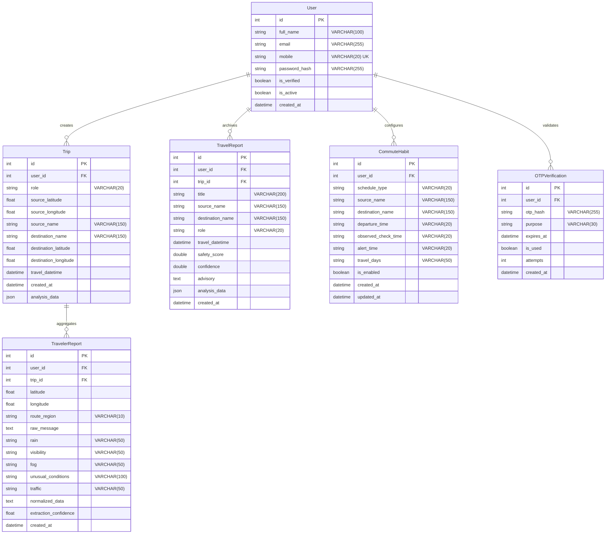

---

## 11.1 Data Tables Specification

### 1. `users` Table
* `id` (INTEGER, Primary Key, Auto-increment): Unique internal identifier for the user.
* `full_name` (VARCHAR(100), Not Null): User's legal name.
* `email` (VARCHAR(255), Nullable, Indexed): Email address.
* `mobile` (VARCHAR(20), Unique, Not Null, Indexed): Mobile number in E.164 format.
* `password_hash` (VARCHAR(255), Not Null): Salted bcrypt password hash.
* `is_verified` (BOOLEAN, Default False): Indicates successful cellular OTP verification.
* `is_active` (BOOLEAN, Default True): Account status flag.
* `created_at` (DATETIME, Default UTC Now): Timestamp of account creation.

### 2. `trips` Table
* `id` (INTEGER, Primary Key, Auto-increment): Unique trip identifier.
* `user_id` (INTEGER, Foreign Key $\rightarrow$ `users.id`): Associated user account.
* `role` (VARCHAR(20), Not Null): Journey persona (`TRAVELER` or `PLANNER`).
* `source_name` / `destination_name` (VARCHAR(150), Not Null): Origin and destination labels.
* `source_latitude` / `source_longitude` (FLOAT): Coordinates for origin point.
* `destination_latitude` / `destination_longitude` (FLOAT): Coordinates for destination point.
* `travel_datetime` (DATETIME, Not Null): Departure timestamp in IST.
* `analysis_data` (JSON, Nullable): Complete serialized evaluation payload.
* `created_at` (DATETIME, Default UTC Now): Creation timestamp.

### 3. `travel_reports` Table
* `id` (INTEGER, Primary Key, Auto-increment): Unique report archive identifier.
* `user_id` (INTEGER, Foreign Key $\rightarrow$ `users.id`): Report owner.
* `trip_id` (INTEGER, Foreign Key $\rightarrow$ `trips.id`): Source trip session.
* `title` (VARCHAR(200), Not Null): Human-readable report headline.
* `safety_score` (DOUBLE, Not Null): Aggregate safety score ($0.0 - 100.0$).
* `confidence` (DOUBLE, Not Null): Statistical confidence index ($0.0 - 1.0$).
* `advisory` (TEXT, Not Null): Executive journey safety summary.
* `analysis_data` (JSON, Not Null): Preserved snapshot of all sector scores, weather, and speeds.
* `created_at` (DATETIME, Default UTC Now): Archival timestamp.

### 4. `traveler_reports` Table
* `id` (INTEGER, Primary Key, Auto-increment): Unique community submission identifier.
* `user_id` (INTEGER, Foreign Key $\rightarrow$ `users.id`): Reporting user.
* `trip_id` (INTEGER, Foreign Key $\rightarrow$ `trips.id`): Active trip session.
* `latitude` / `longitude` (FLOAT): Submission GPS coordinates.
* `route_region` (VARCHAR(10), Not Null, Indexed): Sector classification (`R1` through `R7`).
* `rain` (VARCHAR(50)): Rain category (`none`, `drizzle`, `moderate`, `heavy`).
* `fog` (VARCHAR(50)): Fog category (`none`, `mist`, `dense`).
* `traffic` (VARCHAR(50)): Congestion category (`clear`, `moderate`, `jammed`).
* `unusual_conditions` (VARCHAR(100)): Specific hazards (`rockfall`, `breakdown`, `waterlogging`).
* `extraction_confidence` (FLOAT): NLP extraction confidence score.
* `created_at` (DATETIME, Default UTC Now, Indexed): Submission timestamp for 2-hour TTL sliding window.

### 5. `commute_habits` Table
* `id` (INTEGER, Primary Key, Auto-increment): Unique habit identifier.
* `user_id` (INTEGER, Foreign Key $\rightarrow$ `users.id`): Associated user account.
* `schedule_type` (VARCHAR(20), Default `daily`): Schedule mode.
* `source_name` / `destination_name` (VARCHAR(150)): Selected corridor endpoints.
* `departure_time` (VARCHAR(20), Not Null): Target departure time in `HH:MM` IST.
* `alert_time` (VARCHAR(20), Not Null): Computed alarm time (30 mins before departure).
* `travel_days` (VARCHAR(50), Default `mon,tue,wed,thu,fri`): Active recurring days.
* `is_enabled` (BOOLEAN, Default True): Active notification state.
* `created_at` / `updated_at` (DATETIME): Audit timestamps.

### 6. `otp_verifications` Table
* `id` (INTEGER, Primary Key, Auto-increment): Verification record identifier.
* `user_id` (INTEGER, Foreign Key $\rightarrow$ `users.id`): Target user account.
* `otp_hash` (VARCHAR(255), Not Null): One-way cryptographic hash of 6-digit OTP.
* `purpose` (VARCHAR(30)): Purpose label (`login`, `register`, `reset`).
* `expires_at` (DATETIME, Not Null): Expiry timestamp (10-minute window).
* `is_used` (BOOLEAN, Default False): Single-use redemption flag.
* `attempts` (INTEGER, Default 0): Failed entry counter (locked at 5 attempts).
* `created_at` (DATETIME, Default UTC Now): Generation timestamp.

---

# CHAPTER 12: Grounded Conversational AI Architecture

## 12.1 The Grounding Engine Concept
The platform integrates **LLaMA 3.3 70B Versatile** executed on the **Groq LPU (Language Processing Unit)** infrastructure, providing conversational responses at over **300 tokens per second**.

To satisfy **Axiom 1 (Deterministic Authority)**, the conversational engine operates under a strict grounding pipeline:
1. When a user asks a question in the chatbot interface, the client transmits the active trip context along with the query.
2. The backend retrieves the deterministic evaluation payload for the trip (containing exact regional safety scores, safe speed advisories, weather readings, and active hazard warnings).
3. The backend builds a strict system prompt containing the deterministic payload as immutable facts.
4. The LLM is instructed to answer the user's question using **only** the provided facts. It is strictly prohibited from inventing new scores or performing its own math.

---

## 12.2 Natural Language Affirmation Handling
User interactions during travel frequently involve informal, abbreviated affirmations (such as "ya", "yep", "sure", "ok", or "fine"). Early iterations of the conversational engine failed to recognize these as affirmative confirmations, repeatedly re-asking questions.

The conversational service was refactored with a semantic intent classifier that maps colloquial affirmations to standard logical affirmative intents (`TRUE`), enabling smooth conversational flow.

---

# CHAPTER 13: Mobile Frontend UI/UX Design System

## 13.1 Executive Color Palette & Visual Hierarchy
The mobile frontend implements an executive corporate styling palette designed for high contrast and rapid cognitive processing under direct sunlight:
* **Royal Sapphire (`#1E3A8A`) to Electric Cobalt (`#2563EB`)**: Used across app bars, primary action buttons, and active tabs.
* **Dark Navy Slate (`#0F172A`)**: Primary background canvas and heading typography.
* **Crisp Ice Blue Slate (`#F8FAFC` to `#F1F5F9`)**: Neutral card backgrounds and surfaces.
* **Calibrated Safety Bands**:
  * Critical Hazard Red: `#DC2626`
  * Caution Amber-Orange: `#EA580C`
  * Attention Amber: `#D97706`
  * Good Conditions Mint: `#16A34A`
  * Optimal Safety Emerald: `#059669`

---

## 13.2 Custom Canvas Painting Mechanics

### 1. Elevation Profile Bézier Curve Painter
The corridor elevation profile is rendered using a custom Flutter canvas painter:
1. **Coordinate Normalization**: Key waypoints (km 0 to km 148, elevation 8m to 624m) are mapped to fractional canvas coordinates $(x, y)$.
2. **Cubic Bézier Interpolation**: Smooth cubic Bézier paths are constructed between adjacent waypoints, calculating control points at midpoints to prevent sharp, unnatural vertices:

$$\mathbf{B}(t) = (1-t)^3 \mathbf{P}_0 + 3(1-t)^2 t \mathbf{P}_{\text{control1}} + 3(1-t) t^2 \mathbf{P}_{\text{control2}} + t^3 \mathbf{P}_1, \quad t \in [0, 1]$$

3. **Semi-Transparent Shaded Gradient**: A linear gradient is applied under the curve, fading from semi-transparent cobalt blue at the curve line to transparent at the baseline.
4. **Altimetric Grid Lines**: Horizontal reference grid lines are drawn at 100m, 300m, and 600m with clean typographic altitude labels.
5. **Mountain Summit Pins**: High-elevation points in Bhor Ghat (Khandala and Lonavala Crest) are highlighted with distinctive red indicator pins and concentric rings.

### 2. Solid-Color Dynamic Safety Meter Painter
The safety score meter is rendered as a clean circular gauge:
1. **Background Track**: A light gray circular track (`#E2E8F0`) is drawn with rounded stroke caps.
2. **Solid Dynamic Arc**: The active arc length is swept clockwise from the top vertical center ($-90^\circ$) proportional to the score:

$$\theta_{\text{sweep}} = \left(\frac{\text{Score}}{100.0}\right) \times 2\pi\text{ radians}$$

3. **Dynamic Color Interpolation**: The entire arc is rendered in a single, uniform solid color derived from the piece-wise 5-band safety interpolation function, ensuring clear, unambiguous communication of safety status.

---

# CHAPTER 14: Comprehensive Comparative Benchmark

| Capability Dimension | Standard Google Maps / Waze | Standard Weather App (Weathervane) | Mumbai-Pune Travel Intelligence System |
| :--- | :--- | :--- | :--- |
| **Primary System Objective** | Route ETA minimization | Ambient city temperature | **Multi-Factor Corridor Safety Score ($0 - 100$)** |
| **Micro-Climatic Spatial Resolution** | None (uniform route routing) | Macro city-level | **7 discrete municipal calibrated sectors (R1-R7)** |
| **Mountain Ghat Risk Modeling** | Treats road as flat 2D plane | None | **Dynamic Ghat-Adaptive weighting (ML boosted to 55%)** |
| **Kinematic Braking & Safe Speed** | None (displays statutory limits) | None | **Dynamic physics safe speed advisories & stopping distance** |
| **Temporal Decision Horizon** | Momentary snapshot | 7-day city weather | **Deterministic $\pm 1\text{h}$ departure optimizer & 5-day corridor forecast** |
| **Tunnel Dead-Zone Handling** | Map freezes; no alerts | None | **Pre-cached offline tunnel safety profiles** |
| **Emergency Triage Directory** | Generic search | None | **Direct-dial corridor rescue (IRB, MSRDC 1033, Trauma Centers)** |
| **Decision Authority** | Black-box routing algorithm | Static API feed | **Deterministic Python engine with grounded Groq LLaMA copilot** |

---

# CHAPTER 15: Verification, Security, Risk Analysis & Conclusion

## 15.1 Field Calibration & Verification
During validation testing, system components were calibrated against ground-truth conditions:
* **Municipal Coordinate Pinning**: Setting central municipal coordinates for Mumbai (`19.0760° N, 72.8777° E`) eliminated a recurring 3°C temperature error caused by suburban coastal weather stations.
* **Traffic Radar Calibration**: Google Maps Routes API v2 travel durations were verified against actual expressway toll transit timestamps, validating the 80/20 fusion ratio between commercial radar and verified community reports.

## 15.2 Security Architecture
* **Cryptographic Standards**: Passwords are hashed using salted PBKDF2/bcrypt algorithms. Sessions are verified using signed JWT tokens.
* **Device Storage**: Sensitive tokens and credentials on mobile devices are stored within encrypted hardware keystores via `FlutterSecureStorage`.
* **Transport Security**: All communication between mobile clients, API gateways, external services, and databases is encrypted using TLS 1.3 over HTTPS and SSL.

## 15.3 Engineering Conclusion
The Mumbai-Pune Travel Intelligence platform demonstrates an end-to-end engineering solution that addresses the unique safety hazards of mountain expressway travel:
1. **Deterministic Authority**: All scoring, physics, and decision logic is computed using deterministic Python algorithms, reserving LLMs strictly for conversational presentation.
2. **Terrain & Physics Awareness**: The system models friction coefficients, gradient angles, and stopping distances on the 6% Bhor Ghat descent.
3. **Adaptive Intelligence**: Weights automatically shift toward trained ML models in mountain passes (R4/R5) to counter volatile conditions.
4. **Resilient Architecture**: Offline caching handles tunnel blind spots, while 2-of-3 spatial-temporal consensus prevents fraudulent incident reporting.

This document serves as the complete technical specification, system architecture manual, and algorithmic reference for the Mumbai-Pune Travel Intelligence platform.
